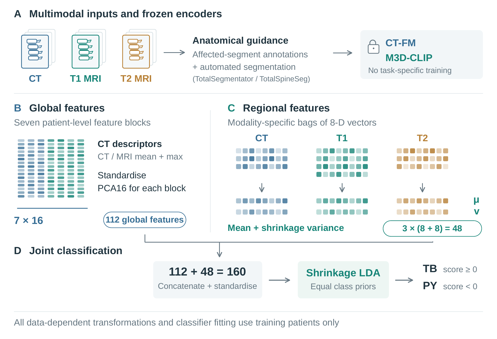

<div align="center">

# spinal-infection-fm

**基于冻结基础模型的解剖引导 CT + MRI 框架，用于鉴别结核性与化脓性脊柱炎**

[](https://www.python.org/)
[](LICENSE)
[](#引用)

**简体中文** | [English](README_en.md)



</div>

---

## 简介

结核性与化脓性脊柱感染的治疗方案不同，但影像表现常有重叠。本仓库提供一个紧凑、可完整复现的鉴别框架：

- 联合使用 **CT、T1 加权和 T2 加权 MRI**；
- 根据 `T11-L1` 这类受累节段标注，用 TotalSegmentator / TotalSpineSeg **自动定位**受累椎体；
- 用**冻结的三维基础模型**（CT-FM、M3D-CLIP）提取特征，不在研究标签上训练任何神经网络；
- 区域特征用**固定的多示例学习（MIL）汇聚**（均值 + 收缩方差）汇总；
- 用 **Ledoit–Wolf 收缩线性判别分析**分类，在特征数多于患者数时依然稳定。

只有最后一个小的线性分类阶段需要用本地数据拟合，因此几百例患者就能运行完整流程，每个判断都能精确分解为各特征组的贡献。

## 特点

| | |
|---|---|
| 🧊 **冻结编码器** | CT 用 CT-FM（SegResEncoder），MRI 用 M3D-CLIP，均不微调 |
| 🦴 **解剖引导 ROI** | 节段标注 + 自动分割，无需人工勾画 |
| 🧩 **固定 MIL 汇聚** | 每个模态的均值与收缩方差 Σ(x−μ)²/(n+2) |
| 📐 **收缩 LDA** | 等先验，阈值固定为 0 |
| 🔒 **无数据泄漏** | 所有标准化、PCA、采样和分类器只在训练患者上拟合 |
| 📊 **含对照模型** | 改编自一篇已发表 ESJ 研究的影像组学、DL 和 DLR 模型 |

## 结果

145 例患者（结核 50 例、化脓 95 例），分层患者级五折交叉验证重复三次。95% 置信区间来自对已保存折外预测的按类别分层患者 bootstrap。

| 模型 | AUC [95% CI] | 准确率 % | 结核敏感度 % | 化脓特异度 % |
|---|---|---|---|---|
| **本框架** | **0.824** [0.754–0.887] | **77.2** | 72.0 | 80.0 |
| 仅 CT | 0.800 [0.725–0.871] | 74.7 | 72.0 | 76.1 |
| 仅 MRI | 0.717 [0.639–0.794] | 66.0 | 57.3 | 70.5 |
| 影像组学（改编） | 0.729 [0.650–0.802] | 66.4 | 71.3 | 63.9 |
| DL（改编） | 0.668 [0.579–0.750] | 62.8 | 67.3 | 60.4 |
| DLR（改编） | 0.695 [0.610–0.774] | 66.2 | 68.7 | 64.9 |

| 消融 | AUC |
|---|---|
| 去掉区域特征 | 0.818 |
| 去掉全局特征 | 0.743 |

> 以上是开发队列上的内部交叉验证结果，**不是**外部验证。ROI 是由节段标注和自动分割得到的解剖代理区域，**不是**人工勾画的病灶掩膜。

## 安装

```bash
git clone https://github.com/tAnGjIa520/spinal-infection-fm.git
cd spinal-infection-fm
conda create -n spinefm python=3.10 -y && conda activate spinefm
pip install -e ".[extract,baselines,test]"
```

[TotalSpineSeg](https://github.com/neuropoly/totalspineseg) 需单独安装，安装后提供 `totalspineseg` 命令。分类和评估只需 CPU；特征提取需要 CUDA GPU。

**预训练权重**（需另行下载，均不微调）：

| 模型 | 来源 | 本地目录应包含 |
|---|---|---|
| CT-FM 特征提取器 | Hugging Face `project-lighter/ct_fm_feature_extractor` | `config.json`、`model.safetensors` |
| M3D-CLIP | Hugging Face `GoodBaiBai88/M3D-CLIP` | `config.json`、`configuration_m3d_clip.py`、`modeling_m3d_clip.py`、`model.safetensors` |
| TotalSegmentator | 首次使用时自动下载 | — |
| ResNet101（对照模型） | torchvision ImageNet 权重，自动下载 | — |

## 数据准备

在 `cohort.csv` 中每名患者一行：

| 列 | 说明 |
|---|---|
| `patient_id` | 匿名编号 |
| `label` | `1` = 结核性，`0` = 化脓性 |
| `levels` | 受累节段，如 `T11-L1;L3`（`;` 分隔多组，`A-B` 表示包含两端的范围） |
| `annotation_reliable` | 可选 `0/1`；为 `0` 时该患者不使用区域特征 |
| `ct_zip`、`t1_zip`、`t2_zip` | 每个序列一个 DICOM ZIP 的路径（仅第 1 步需要） |

```
data/
├── nifti/       <id>_CT.nii.gz, <id>_T1w.nii.gz, <id>_T2w.nii.gz
├── ct_seg/      <id>_CT_vertebrae.nii.gz
└── mri_seg/     T1w/step2_output/<id>_T1w.nii.gz, T2w/step2_output/<id>_T2w.nii.gz
```

## 使用方法

**第 1 步：DICOM 转 NIfTI**
```bash
python scripts/convert_dicom.py --manifest cohort.csv --out data/nifti
```

**第 2 步：脊柱分割**
```bash
python scripts/segment_ct.py --nifti data/nifti --out data/ct_seg      # TotalSegmentator
bash   scripts/segment_mri.sh data/nifti data/mri_seg                    # TotalSpineSeg
```

**第 3 步：用冻结编码器提取特征**
```bash
python scripts/extract_features.py --cohort cohort.csv --nifti data/nifti \
    --ct-seg data/ct_seg --mri-seg data/mri_seg \
    --ctfm weights/ct_fm_feature_extractor --m3dclip weights/m3d_clip --out features
```

**第 4 步：交叉验证框架及消融**
```bash
python scripts/cross_validate.py --features features --out results
```
输出折外分数、所用划分（`splits.csv`）以及带 bootstrap 95% CI 的 `summary.csv`。

**第 5 步（可选）：对照模型**
```bash
python scripts/extract_baseline_features.py --cohort cohort.csv --nifti data/nifti \
    --ct-seg data/ct_seg --mri-seg data/mri_seg --out baseline_features
python scripts/cross_validate_baselines.py --features baseline_features \
    --splits results/splits.csv --out results            # 加 --mri-only 只用 T1+T2
```

**Python 接口**
```python
from pathlib import Path
from spinefm import AnatomyGuidedLDA, Seeds
from spinefm.features import load_cohort

cohort = load_cohort(sorted(Path("features").glob("*.npz")))
model = AnatomyGuidedLDA().fit(cohort, train_idx, Seeds.for_fold(repeat=0, fold=0))
scores = model.decision_function(cohort, test_idx)   # >= 0 判为结核
```

## 目录结构

```
src/spinefm/
├── anatomy.py      节段解析、分割标签映射、ROI 几何
├── ct.py           CT 读取、TotalSegmentator、CT-FM 编码、CT 描述符
├── mri.py          MRI 读取、M3D-CLIP 区域嵌入
├── features.py     每名患者的全局特征与区域实例包
├── framework.py    训练折内 PCA、MIL 汇聚、收缩 LDA
├── evaluation.py   重复交叉验证、指标、bootstrap
└── baselines.py    影像组学 / DL / DLR 对照模型
scripts/            命令行流程（第 1–5 步）
tests/              合成数据单元测试（`pytest -q`）
```

## 可复现性

使用研究队列的缓存特征和原始划分，本代码复现了论文报告的折外分数（最大差异 2 × 10⁻⁵，无任何预测改变）、置信区间、消融结果以及对照模型的预测（差异为 0）。在 PyTorch 2.9 / CUDA 12.8 下重新运行冻结编码器可精确复现缓存嵌入；其他软件环境可能带来很小的数值差异（余弦相似度 ≥ 0.9999）。

## 数据可用性

研究使用的患者影像、特征和预测**不公开**。本仓库只包含代码。

## 引用

论文正在审稿中，发表后将在此补充 BibTeX。

## 致谢

本工作基于 [TotalSegmentator](https://github.com/wasserth/TotalSegmentator)、[TotalSpineSeg](https://github.com/neuropoly/totalspineseg)、[CT-FM](https://huggingface.co/project-lighter/ct_fm_feature_extractor)、[M3D](https://github.com/BAAI-DCAI/M3D)、[PyRadiomics](https://github.com/AIM-Harvard/pyradiomics) 和 [scikit-learn](https://scikit-learn.org/)。README 版式参考了 [CLAM](https://github.com/mahmoodlab/CLAM)。

## 许可证

本项目以 [MIT 许可证](LICENSE)发布。预训练模型遵循各自的许可证。
